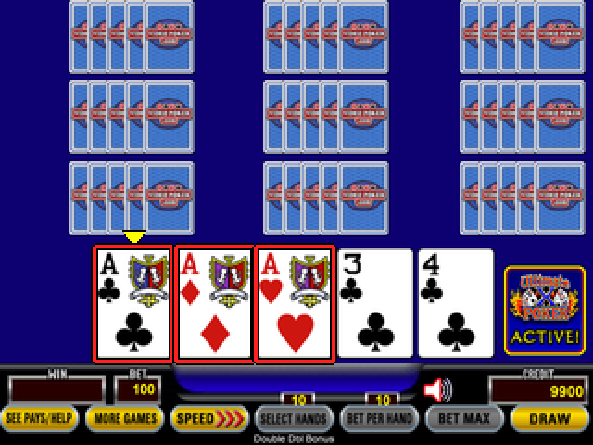
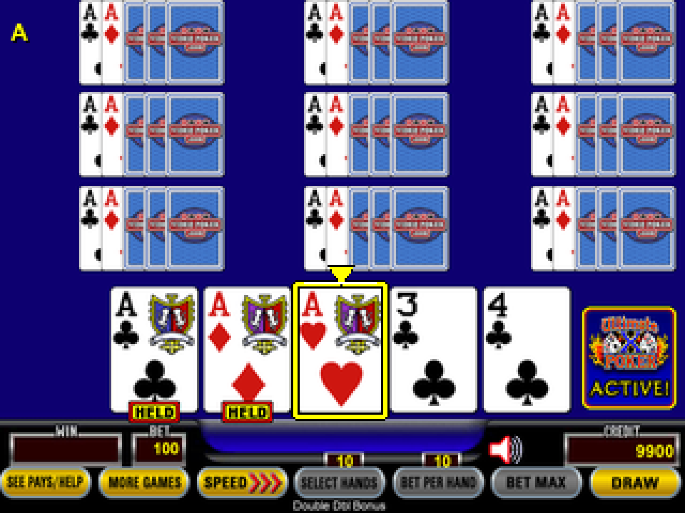

<p align="center">
  
</p>
<p align="center"><em>Running on SeedSigner Play.</em></p>

# Video Poker

**Ten hands of Double Double Bonus. One SeedSigner Play.**

An independent, offline video poker frontend for SeedSigner Play and compatible Plus hardware. Play classic 10-hand **9/6 Double Double Bonus** with next-hand multipliers, then use the outer-button gesture to open SeedSigner. Use best-hold hints or let autoplay play the hands. Virtual credits only; game state resets when powered off.

[Download v0.4.1](https://github.com/xberenguer/videopoker/releases/tag/v0.4.1) · [Build and validation](docs/TECHNICAL.md) · [Licenses and credits](#licenses-and-credits)

This is an experimental community project, not an official SeedSigner, BitKit, IGT, Action Gaming or VideoPoker.com release.

## Screenshots

Actual software-rendered game screens at **320 × 240**, enlarged for readability.

<table>
  <tr>
    <td align="center"><br><strong>Ready to deal</strong></td>
    <td align="center"><br><strong>Select cards and hold</strong></td>
  </tr>
  <tr>
    <td align="center"><br><strong>Ten-hand draw results</strong></td>
    <td align="center"><br><strong>Next-hand multipliers</strong></td>
  </tr>
  <tr>
    <td align="center"><br><strong>Bottom-row control selection</strong></td>
    <td align="center"><br><strong>9/6 paytable and multiplier schedule</strong></td>
  </tr>
  <tr>
    <td align="center"><br><strong>Individual hand inspection</strong></td>
    <td align="center"><br><strong>Built-in help</strong></td>
  </tr>
  <tr>
    <td align="center"><br><strong>Hold UP to peek</strong></td>
    <td align="center"><br><strong>Hands-free autoplay</strong></td>
  </tr>
</table>

## Get started

Designed for a **Raspberry Pi Zero 1.3** with the **320 × 240 ST7789** display and standard SeedSigner buttons, including SeedSigner Play and compatible Plus HATs. Other boards and the regular 240 × 240 display are not qualified by this release.

1. Download `seedsigner-v0.8.7-poker-v0.4.1-play-plus-pi0.img` and its matching `.sha256` file from the [v0.4.1 release](https://github.com/xberenguer/videopoker/releases/tag/v0.4.1).
2. Verify the download with `shasum -a 256 -c seedsigner-v0.8.7-poker-v0.4.1-play-plus-pi0.img.sha256`.
3. In Raspberry Pi Imager, choose **Use custom**, select the IMG and write it to your intended microSD card. This erases that card; let verification finish.
4. Insert the card and power on. The device starts in poker.

To open SeedSigner, hold the **top + bottom action buttons** together for **two seconds**, then release **every button**. Reboot to return to poker.

## Controls

| Button | Action |
| --- | --- |
| D-pad left / right | Select a card; move between focused gold controls |
| Either middle button: D-pad center or right middle | Hold / unhold the selected card; after completed results, deal the next hand; confirm in menus |
| D-pad DOWN | Deal / Draw; skip a running animation without placing another bet |
| D-pad UP | Hold to peek at the best hold; release to clear. Click three times, with at most 350 ms between adjacent clicks, to start autoplay |
| Top action button | Hold / unhold; after results, open hand details |
| Bottom action button | Focus the gold controls; return to cards or leave a menu |
| Up / down inside menus or result details | Navigate the current menu or result hands |
| Top + bottom, hold two seconds, then release all | Open SeedSigner |

The selected card has a bold yellow border and pointer. Recommended cards have solid **red** borders only while UP is held; release clears the peek. Autoplay uses the ordinary yellow selection and HELD tags. The selected gold control has a full white outline. Any button click stops autoplay and is consumed without dealing, changing a hold or opening a menu. Press again for its normal action. Autoplay also pauses if credits, randomness or advice are unavailable; it never refills credits automatically.

## Hints and autoplay

Hold **UP** after a deal to peek at the recommended cards in solid red. Release UP to return immediately to the normal board. There are no hint banners or extra screens. Click **UP three times** to start autoplay. A small yellow **A** appears at the top left while it is active. Click any button to stop; that click performs no other action. Menus keep their ordinary navigation controls.

Autoplay plays at a human pace: it considers the dealt hand for at least six seconds, selects cards from left to right at 0.65 seconds per card, waits two seconds after choosing holds, then draws. Settled results remain visible for four seconds before the next deal. It uses the normal yellow card pointer and HELD tags, with no red hints or extra banners. The small yellow A is the only autoplay indicator. A round normally takes about 15–18 seconds, depending on animation and advice time.

The advisor evaluates all 32 holds using exhaustive counts for the remaining 47-card deck. In ten-hand feature play, its numerical expected-value strategy accounts for both the **current multipliers** and the value of the **next hand's multipliers**. Ordinary lower-coin play uses payout expected value. It sees only the visible hand and round settings; it cannot predict the next draw.

The continuation strategy uses floating-point calculations with a numerical convergence check. This is not a formal proof, casino certification or a guarantee of winning. Strategy data loads on first use in a cancellable worker, which must stop before SeedSigner opens. [Method and limits](docs/TECHNICAL.md#hints-and-autoplay).

## In this version

- Ten hands, shared initial cards and holds, with independent replacement decks.
- The classic ten-play 9/6 Double Double Bonus paytable and next-hand multiplier schedule.
- One to ten active hands, bet controls, paytable/help screens and result inspection.
- Both middle buttons hold or confirm and start the next hand after results; DOWN deals and draws.
- Hold-to-peek solid red best-hold borders and human-paced autoplay, with multiplier-aware numerical strategy.
- Responsive physical input sampled independently of drawing; held Deal does not repeat.
- Cached badge rendering and crisp selection borders sized for the actual LCD.
- RAM-only credits and multipliers. No accounts, networking, real-money wagering or cash-out.

The display uses the reference site's card and interface artwork with independently written gameplay code. See the separate asset-rights notice below.

## Validation

Stock ARMv6 functional emulation also passed three paced autoplay rounds and the held-hint/release pixel checks, captured-timestamp triple-click activation, the A indicator and consumed-button cancellation. Its virtual instruction and presentation clocks do not qualify physical timing.

The current source passes **188 functional host checks**, with no failures, errors or skips. Wall-clock input timing remains unqualified under host contention. The [validation reports](validation/release-validation.json) record source-bound host checks, independent enumeration of **2,598,960 five-card hands**, image readback and stock ARMv6 runtime checks. The hint/autoplay tests cover cancellation, stale results, animation guards, insufficient credits and worker shutdown. Strategy counts are independently enumerated, and the full-game policy is checked numerically. See the reports for the exact release results and scope.

The supplied photo shows the game on physical SeedSigner Play hardware. It does not establish the exact image hash or a complete camera/signing round trip. Emulator timings are not physical Pi performance measurements. This release has not completed physical cold-boot, button, camera and signing qualification.

The game and signer share one operating system. The entry gesture is an interface gate, not authentication or isolation. Full wallet qualification requires a cold boot, all controls, camera scanning and a signing round trip with a disposable test seed.

## Build it yourself

The image is based on the signed official **SeedSigner 0.8.7 Pi Zero** release. The kernel, firmware and upstream signer application are retained.

Build dependencies, the pinned base checksum and public signing key, reproduction commands and math details are in [the technical guide](docs/TECHNICAL.md). Development dependencies are listed in [requirements-dev.txt](requirements-dev.txt).

Run host tests from the repository root:

```sh
python3 -m pip install -r requirements-dev.txt
PYTHONDONTWRITEBYTECODE=1 python3 -B -m pytest -q -p no:cacheprovider
```

Some checks require the pinned base image or the installed macOS Arial fonts. Some environment-dependent tests can report conditional skips in a fresh checkout. The packaged PNG assets are sufficient to build and run the game without installing those source fonts.

## Licenses and credits

- Original game logic, integration and build code: **GPL-2.0-or-later**, see [LICENSE](LICENSE) and [NOTICE](NOTICE).
- [SeedSigner](https://github.com/SeedSigner/seedsigner) and its OS components retain their own licenses. The technical guide links the stock OS corresponding source.
- Card/interface artwork, logos and rasterized Arial glyphs retain their original owners' rights. They are **not relicensed under this project's GPL**. No separate public redistribution permission is recorded in this repository. See [third-party notices](payload/opt/dino/THIRD-PARTY-ASSETS.txt) and the [per-file provenance manifest](payload/opt/dino/assets/videopoker/manifest.json).
- Header photo: supplied by the project owner for this README; it is separate from the GPL code license.

Historical release artifacts remain available unchanged; their local-build notices describe how those artifacts were prepared. This repository's documentation does not grant additional rights to third-party artwork, marks or fonts.
