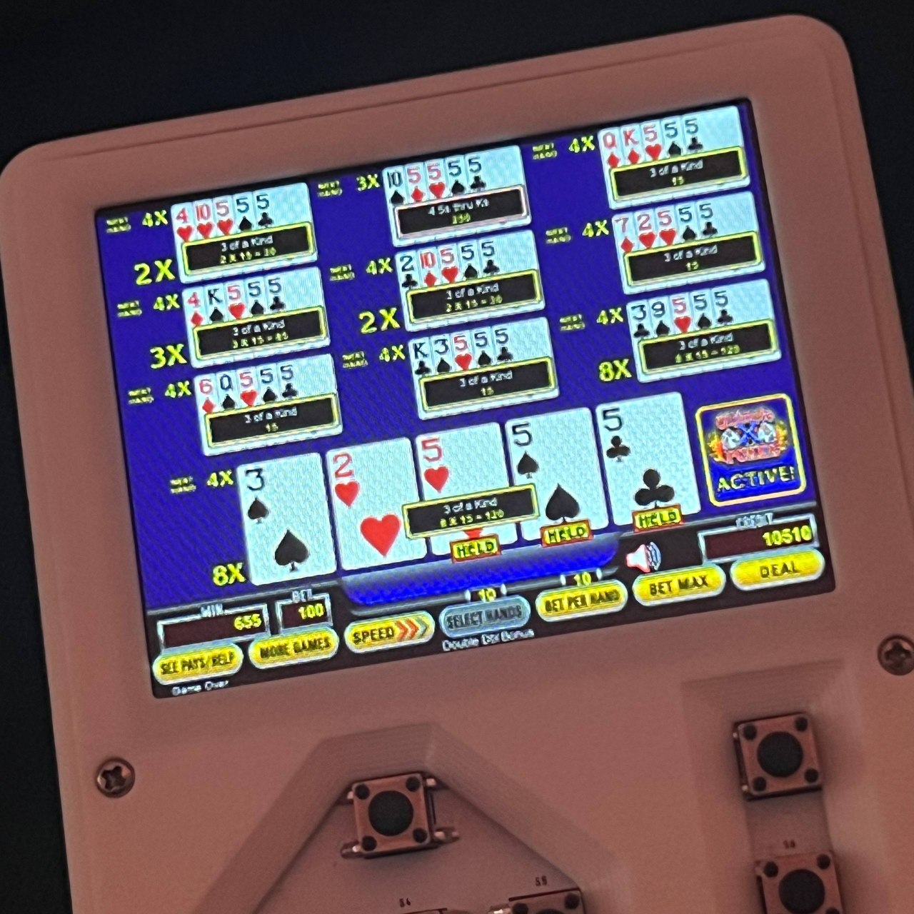

# Video Poker

An offline, twelve-game video poker cabinet with best-hold hints, three autoplay modes, an EV calculator and a hidden trainer. Built for a **Raspberry Pi Zero 1.3, 320 × 240 ST7789 display, D-pad with center button and three action buttons**. Virtual credits only; no account or connection required.

**v0.6.6:** optional persistent memory with explanations, general Settings with brightness and animation speed, verified DDB paytable presets, automatic calculator results and immediate right-button trainer-sidebar entry.

[Download IMG](https://github.com/xberenguer/videopoker/releases/download/v0.6.6/videopoker-v0.6.6-pi0-320x240.img) · [SHA-256](https://github.com/xberenguer/videopoker/releases/download/v0.6.6/videopoker-v0.6.6-pi0-320x240.img.sha256) · [Matching source](https://github.com/xberenguer/videopoker/releases/download/v0.6.6/videopoker-v0.6.6-source.tar.gz)

[Complete user guide](docs/USER-GUIDE.md) · [All menus and settings](docs/USER-GUIDE.md#general-settings) · [Trainer and statistics](docs/USER-GUIDE.md#hidden-trainer) · [Build and validation](docs/TECHNICAL.md) · [Licenses and credits](NOTICE)

## Quick install

1. Download the **IMG** and matching **.sha256** from the same release. Verify the checksum; [commands](docs/USER-GUIDE.md#install-and-first-boot) are in the guide.
2. Install [Raspberry Pi Imager](https://www.raspberrypi.com/software/) and insert your microSD card into the computer.
3. Select **Raspberry Pi Zero** as the device. Under the OS selection, choose **Use Custom** and select the downloaded `.img`.
4. Select the intended microSD card as storage. Writing replaces its contents.
5. Skip OS customisation such as Wi-Fi/SSH, then write the image. Approve any system authorisation and let verification finish.
6. Eject the card, insert it into the powered-off handheld, then power on. The first cabinet tile is selected; choose a game and press DOWN to deal.

Imager versions vary in layout. These steps follow the [official Raspberry Pi installation guide](https://www.raspberrypi.com/documentation/computers/getting-started.html#install-an-os-onto-boot-media); this custom offline image does not use normal Raspberry Pi OS customisation. Do not flash the source `.tar.gz` archive.

## Play

| Input | Action |
| --- | --- |
| LEFT / RIGHT | Select cards or bottom machine controls |
| Either middle button | Hold/unhold, select, or next deal after results |
| DOWN | Deal / Draw |
| Hold UP | Red best-hold peek after 0.30 seconds; release hides it |
| Double UP | Apply best holds manually; change mode during autoplay |
| Triple UP | Toggle autoplay on/off |
| Cabinet BOTTOM | General Settings |
| Hold right-column TOP + BOTTOM for two seconds | Toggle the live trainer sidebar on/off immediately, before release |

When no cards should be held, held-UP flashes the actual Draw button red. Fast taps deliberately do not show the red hint. Both middle buttons retain their card-hold/next-hand behavior.

Autoplay starts in **AM**: DOWN deals, then another DOWN applies the best hold and draws immediately. Double UP cycles **AM → Medium → Fast**. The small footer indicator uses `A M`, one filled triangle or two filled triangles. UP does not cancel autoplay except an explicit triple tap; AM also keeps autoplay active when DOWN is pressed. See the [complete control guide](docs/USER-GUIDE.md#physical-controls).

| Cabinet | Ten-hand play |
| --- | --- |
| 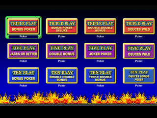 | 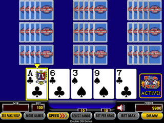 |
| 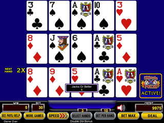 | 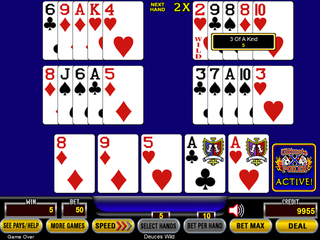 |

## Settings and Vegas paytables

General Settings includes **brightness, manual animation speed, paytable presets, persistent memory and virtual-credit reset**. Each setting has a short explanation. Three- and ten-hand Double Double Bonus offer **9/6, 9/5, 8/5 and 7/5**, with matching payout and offline strategy data. Other games retain their original cabinet tables.

The ten-hand **7/5 DDB** preset matches the [supplied South Point paytable photo](docs/images/south-point-ddb-75.jpg), including its multiplier schedule. Casino names do not establish one universal configuration. Review the actual awards and multipliers; [preset details](docs/USER-GUIDE.md#paytable-presets-and-vegas-configurations) explain what is verified.

| General settings | Optional memory |
| --- | --- |
| 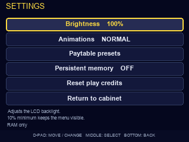 | 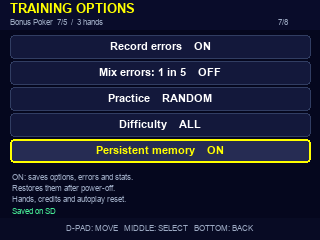 |

## Memory

**OFF is the factory default.** Training and device settings stay in RAM and disappear after power-off. ON saves device preferences, per-preset training settings, error history and statistics. Turning OFF clears the saved copies while keeping the current RAM session. A separate confirmed **Clear training data** action resets training records while preserving device settings and the memory preference.

Cards, held flags, live credits, game multipliers, RNG state and active autoplay always reset after power-off. Boot always selects the first cabinet tile, **Triple Play Bonus Poker**. The program checks the saved preference at startup; OFF does not mean that boot performs no SD reads. [Storage behavior and save status](docs/USER-GUIDE.md#persistent-memory).

## Trainer and calculator

Ordinary gameplay has no training labels or sidebar. The hidden trainer offers TEST/COACH modes, inline error feedback, live Advice/EV/Stats panels, all 32 hold alternatives, payout probabilities, error review/replay, practice drills and separate autoplay statistics. Assisted decisions stay separate from personal accuracy.

The calculator starts automatically when the fifth card is confirmed, then refreshes after complete-hand input changes. It displays **EV**, **NOW** and **NEXT**, with **COMPARE EV** for the full ranked list. It uses the selected game's exact paytable, deck and current multiplier board.

| Live coach | Inline error feedback |
| --- | --- |
| 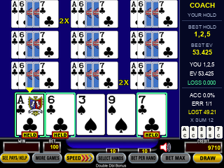 | 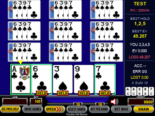 |
| 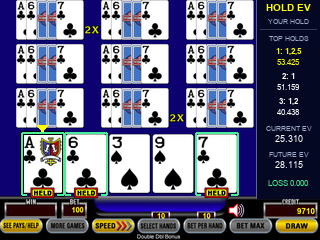 | 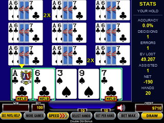 |
| 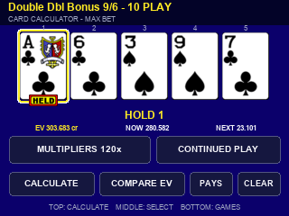 | 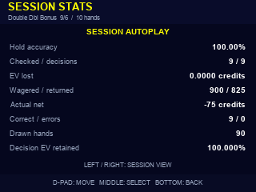 |

EV retained measures decision quality; it is not casino RTP or a profit guarantee. Continued-play values use a numerical all-1× reference. Identical vendor XEV formatting is not claimed. [EV definitions and limits](docs/USER-GUIDE.md#statistics-and-ev).

## Build and verification

See [technical notes](docs/TECHNICAL.md) for the pinned base OS, source assembly, tests, numerical policy generation and release evidence. Host and stock ARM emulation checks cover all twelve games and the additional paytable policies. Physical cold boot, LCD/PWM behavior, GPIO and Pi timing still need hardware testing.

This independent community project is not an official casino or game-vendor release. Original code is GPL-2.0-or-later; third-party components, artwork, marks and font-derived bitmaps retain their own rights. See [LICENSE](LICENSE), [NOTICE](NOTICE) and `payload/opt/dino/THIRD-PARTY-ASSETS.txt`.
