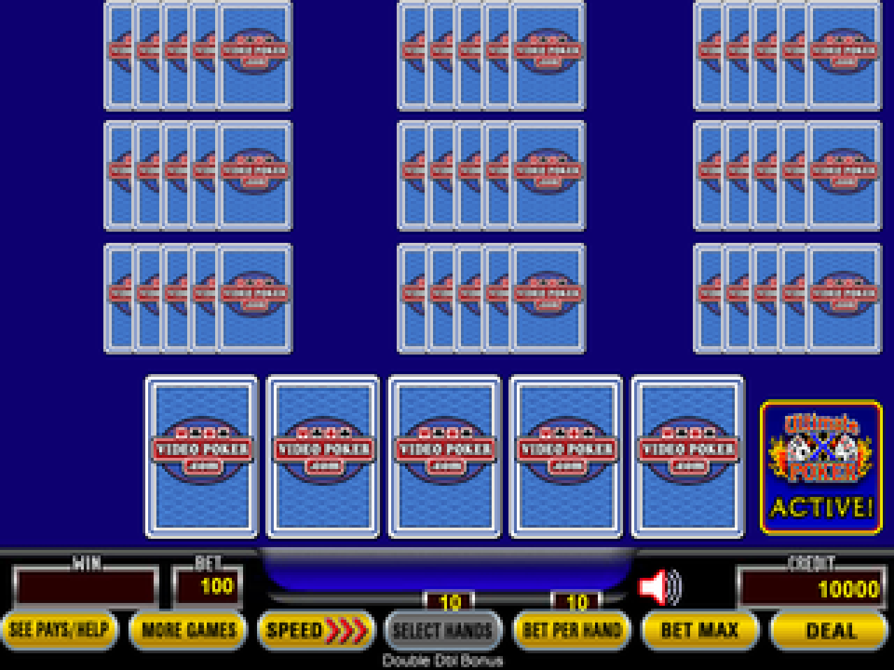
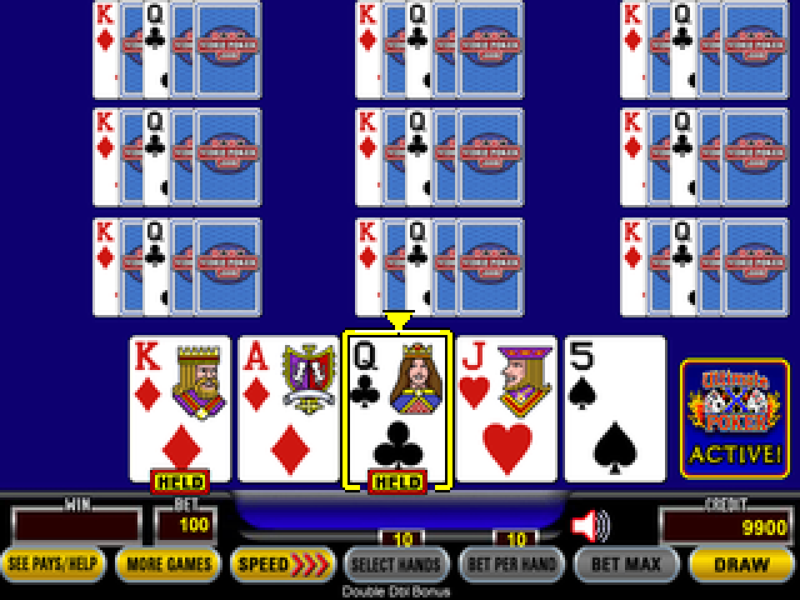
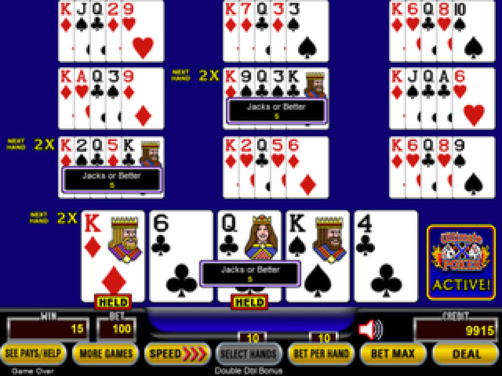
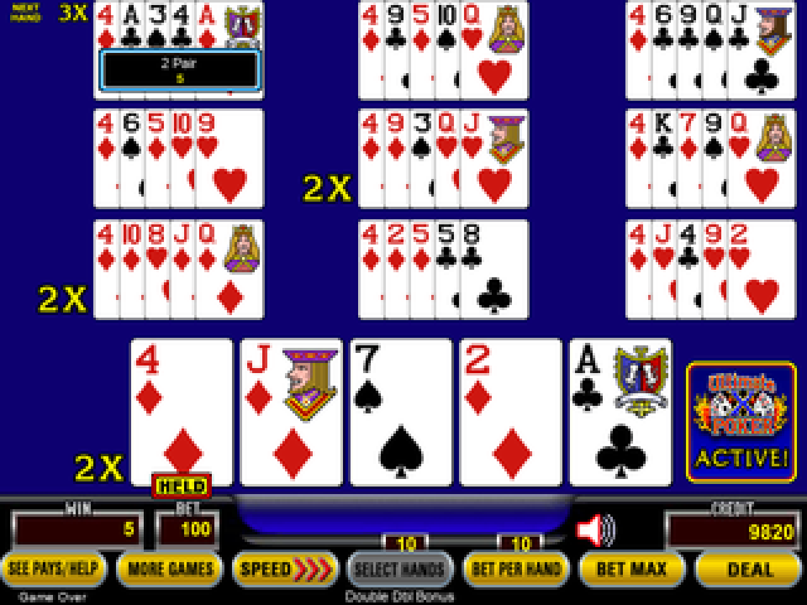
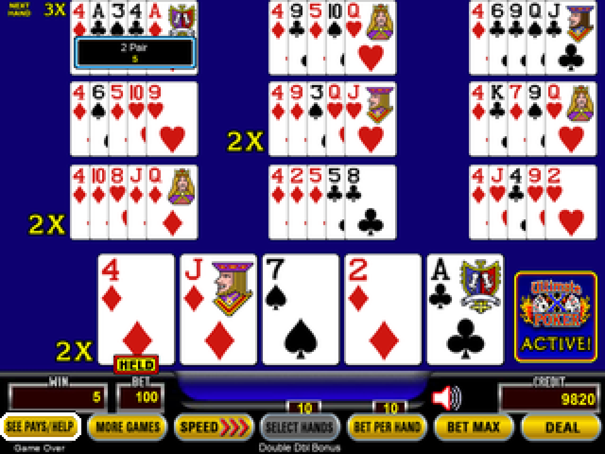
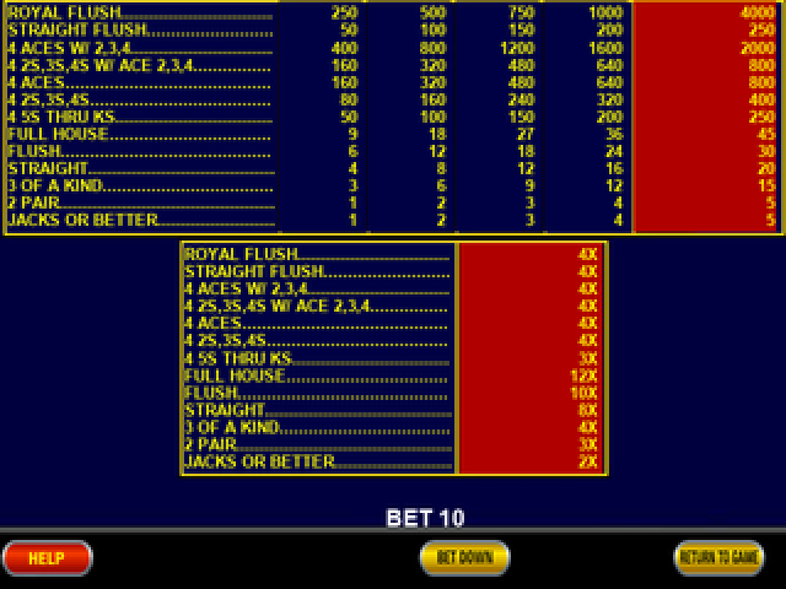
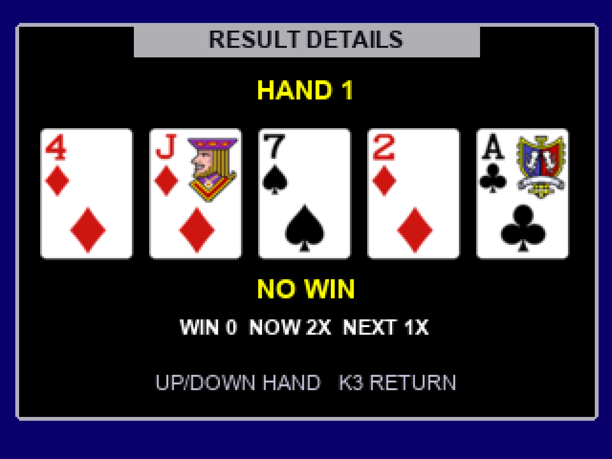
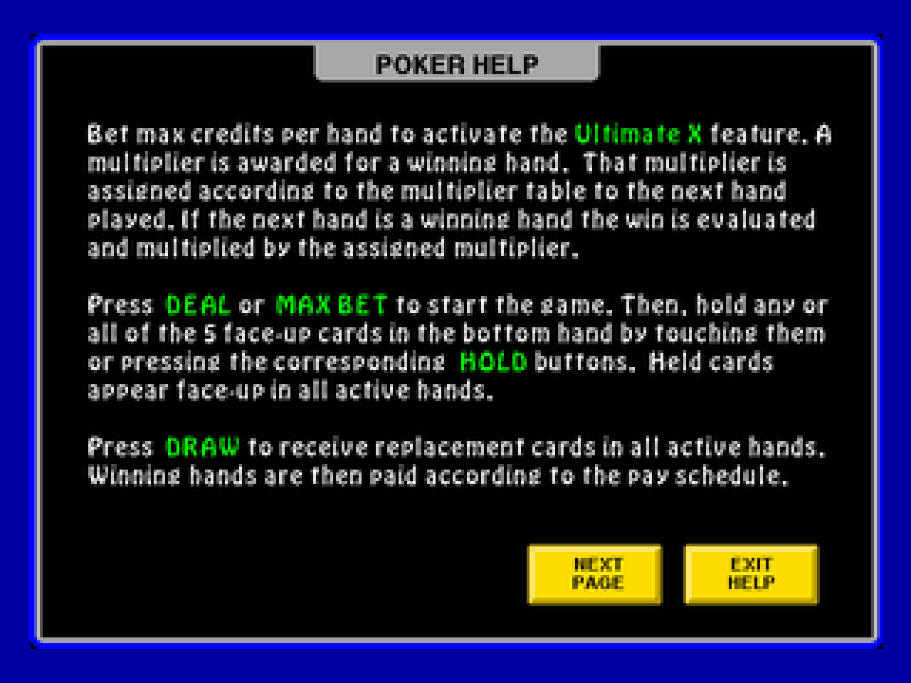

<p align="center">
  
</p>
<p align="center"><em>Running on SeedSigner Play.</em></p>

# Video Poker

**Ten hands of Double Double Bonus. One SeedSigner Play.**

An independent, offline video poker frontend for SeedSigner Play and compatible Plus hardware. Play classic 10-hand **9/6 Double Double Bonus** with next-hand multipliers, then use the outer-button gesture to open SeedSigner. Virtual credits only; game state resets when powered off.

[Download v0.3.1](https://github.com/xberenguer/videopoker/releases/tag/v0.3.1) · [Build and validation](docs/TECHNICAL.md) · [Licenses and credits](#licenses-and-credits)

This is an experimental community project, not an official SeedSigner, BitKit, IGT, Action Gaming or VideoPoker.com release.

## Screenshots

Actual software-rendered game screens at **320 × 240**, enlarged for readability.

<table>
  <tr>
    <td align="center"><br><strong>Ready to deal</strong></td>
    <td align="center"><br><strong>Select cards and hold</strong></td>
  </tr>
  <tr>
    <td align="center"><br><strong>Ten-hand draw results</strong></td>
    <td align="center"><br><strong>Next-hand multipliers</strong></td>
  </tr>
  <tr>
    <td align="center"><br><strong>Bottom-row control selection</strong></td>
    <td align="center"><br><strong>9/6 paytable and multiplier schedule</strong></td>
  </tr>
  <tr>
    <td align="center"><br><strong>Individual hand inspection</strong></td>
    <td align="center"><br><strong>Built-in help</strong></td>
  </tr>
</table>

## Get started

Designed for a **Raspberry Pi Zero 1.3** with the **320 × 240 ST7789** display and standard SeedSigner buttons, including SeedSigner Play and compatible Plus HATs. Other boards and the regular 240 × 240 display are not qualified by this release.

1. Download the IMG and its matching `.sha256` file from the [release](https://github.com/xberenguer/videopoker/releases/tag/v0.3.1).
2. Verify the download with `shasum -a 256 -c seedsigner-v0.8.7-poker-v0.3.1-play-plus-pi0.img.sha256`.
3. In Raspberry Pi Imager, choose **Use custom**, select the IMG and write it to your intended microSD card. This erases that card; let verification finish.
4. Insert the card and power on. The device starts in poker.

To open SeedSigner, hold the **top + bottom action buttons** together for **two seconds**, then release **every button**. Reboot to return to poker.

## Controls

| Button | Action |
| --- | --- |
| D-pad left / right | Select a card; select a gold control when that row has focus |
| D-pad up / down | Select a result hand; navigate menus |
| D-pad center or top action button | Hold / unhold a card; activate the focused control |
| Middle action button | Deal / Draw; skip a running animation without placing another bet |
| Bottom action button | Focus the gold controls; return to cards or leave a menu |
| Top + bottom, hold two seconds, then release all | Open SeedSigner |

The selected card has a bold yellow border and pointer. The selected gold control has a full white outline.

## In this version

- Ten hands, shared initial cards and holds, with independent replacement decks.
- The classic ten-play 9/6 Double Double Bonus paytable and next-hand multiplier schedule.
- One to ten active hands, bet controls, paytable/help screens and result inspection.
- Responsive physical input sampled independently of drawing; held Deal does not repeat.
- Cached badge rendering and crisp selection borders sized for the actual LCD.
- RAM-only credits and multipliers. No accounts, networking, real-money wagering or cash-out.

The display uses the reference site's card and interface artwork with independently written gameplay code. See the separate asset-rights notice below.

## Validation

The original v0.3.1 validation passed **130 host tests**, an independent exhaustive check of **2,598,960 five-card hands**, and stock ARMv6 runtime checks. Short taps were captured during blocked display writes and full rendering. Image rebuilds were byte-identical.

The supplied photo shows the game on physical SeedSigner Play hardware. It does not establish the exact image hash or a complete camera/signing round trip. The archived [validation reports](validation/release-validation.json) describe their precise software-test scope; emulator timings are not physical Pi performance measurements.

The game and signer share one operating system. The entry gesture is an interface gate, not authentication or isolation. Full wallet qualification requires a cold boot, all controls, camera scanning and a signing round trip with a disposable test seed.

## Build it yourself

The image is based on the signed official **SeedSigner 0.8.7 Pi Zero** release. The kernel, firmware and upstream signer application are retained.

Build dependencies, the pinned base checksum and public signing key, reproduction commands and math details are in [the technical guide](docs/TECHNICAL.md). Development dependencies are listed in [requirements-dev.txt](requirements-dev.txt).

Run host tests from the repository root:

```sh
python3 -m pip install -r requirements-dev.txt
PYTHONDONTWRITEBYTECODE=1 python3 -B -m pytest -q -p no:cacheprovider
```

Some checks require the pinned base image or the installed macOS Arial fonts. The original 130-test result was collected in its documented environment; a fresh Linux checkout can report conditional skips. The packaged PNG assets are sufficient to build and run the game without installing those source fonts.

## Licenses and credits

- Original game logic, integration and build code: **GPL-2.0-or-later**, see [LICENSE](LICENSE) and [NOTICE](NOTICE).
- [SeedSigner](https://github.com/SeedSigner/seedsigner) and its OS components retain their own licenses. The technical guide links the stock OS corresponding source.
- Card/interface artwork, logos and rasterized Arial glyphs retain their original owners' rights. They are **not relicensed under this project's GPL**. No separate public redistribution permission is recorded in this repository. See [third-party notices](payload/opt/dino/THIRD-PARTY-ASSETS.txt) and the [per-file provenance manifest](payload/opt/dino/assets/videopoker/manifest.json).
- Header photo: supplied by the project owner for this README; it is separate from the GPL code license.

The original release payload and archived source are retained byte-for-byte; historical local-build wording in their notices describes how those artifacts were prepared. This repository's documentation does not grant additional rights to third-party artwork, marks or fonts.
