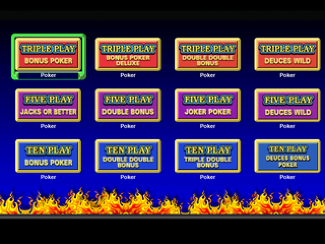
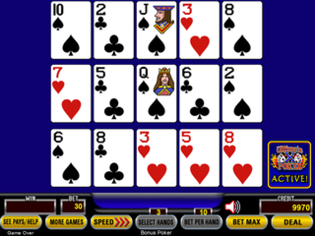
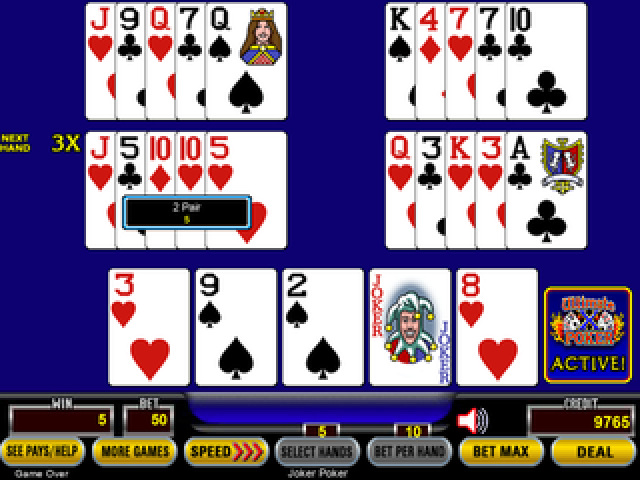
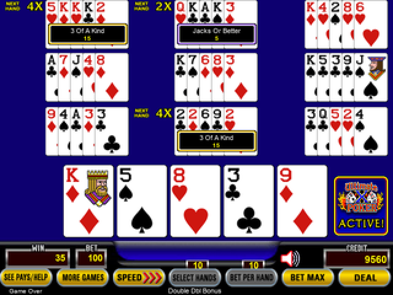
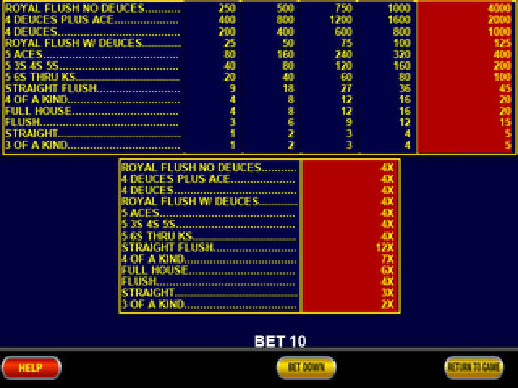
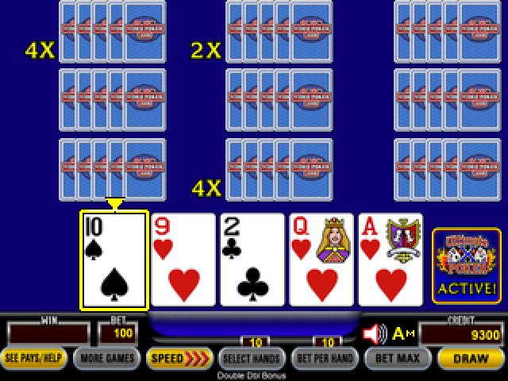

# Video Poker

An offline Ultimate X style video poker cabinet for **SeedSigner Play / compatible Plus hardware**, with the twelve-game menu, three-, five- and ten-hand layouts, game-specific paytables, next-hand multipliers, hints and autoplay. Version **0.5.1** includes the twelve-game cabinet, triple-UP autoplay toggle, and fixed maximum wagers.

[Download IMG](https://github.com/xberenguer/videopoker/releases/download/v0.5.1/seedsigner-v0.8.7-poker-v0.5.1-play-plus-pi0.img) · [SHA-256](https://github.com/xberenguer/videopoker/releases/download/v0.5.1/seedsigner-v0.8.7-poker-v0.5.1-play-plus-pi0.img.sha256) · [Matching source](https://github.com/xberenguer/videopoker/releases/download/v0.5.1/seedsigner-poker-v0.5.1-source.tar.gz)

Virtual credits only. State stays in RAM and resets when powered off. This is an independent community project; third-party graphics keep their original rights. It is not an official SeedSigner, BitKit, IGT, Action Gaming or VideoPoker.com release.

## Screenshots

Actual software renders at 320 × 240, enlarged for readability.

| Cabinet | Three hands |
| --- | --- |
|  |  |
| Five hands | Ten hands |
|  |  |
| Deuces Bonus paytable | Manual autoplay |
|  |  |

## Games

| Three hands | Five hands | Ten hands |
| --- | --- | --- |
| Bonus Poker | Jacks or Better | Bonus Poker |
| Bonus Poker Deluxe | Double Bonus | Double Double Bonus |
| Double Double Bonus | Joker Poker | Triple Double Bonus |
| Deuces Wild | Deuces Wild | Deuces Bonus Poker |

The menu opens on boot. Every game is fixed at **max bet with all 3, 5 or 10 hands active**: ten credits per hand, made up of five base credits plus five feature credits. Tile selection prepares this full board without spending credits; DOWN deals. Bet Per Hand and Select Hands are disabled in this cabinet. BET MAX remains a Deal shortcut. Joker Poker uses a 53-card deck; Deuces Wild variants use wild twos. Triple Double Bonus includes the reference's lower-coin royal and aces-with-kicker exceptions.

Returning from More Games preserves the entire current game. Selecting a tile clears the cards, restores the full max-bet board, preserves shared credits, and restores that game's pending multipliers. Games cannot be changed during a live hand.

## Controls

- **D-pad:** navigate the cabinet menu. Either middle button selects a game; bottom right returns from a menu when a game is open.
- **LEFT / RIGHT:** select a card. **Either middle:** hold/unhold; advance to the next deal after results.
- **DOWN:** Deal / Draw. A fresh DOWN during draw-result presentation immediately deals the next hand; during a deal reveal it only finishes revealing. Held buttons do not repeat.
- **UP held for 0.30 seconds, during manual play:** peek at best holds with solid red borders. Release clears the hint. When holding nothing is best, the Draw button flashes red. Brief multi-taps do not show red.
- **Double UP during manual play:** select all best holds without drawing.
- **Triple UP:** toggle autoplay on/off. Every activation starts in **M**.
- **During autoplay:** double UP cycles **M → Medium → Fast → M**. Triple UP turns autoplay off without also changing speed. Single/held UP keeps autoplay active. Other buttons stop it and consume that click, except DOWN in M.
- **M:** DOWN deals and waits for you to think; the next DOWN applies best holds together and draws immediately. Results wait for the next DOWN. No artificial pauses or card animations. A tiny M appears beside A.
- **Medium / Fast:** fully automatic, with one / two small filled yellow triangles beside A. They retain the established study, selection and result timings.
- **Top right:** inspect completed hands. **Bottom right:** select the gold controls; either middle activates the selected control.
- **SeedSigner:** hold the outer right top and bottom buttons for two seconds, then release all buttons. Autoplay stops, workers close and GPIO/SPI are released before the unchanged signer application starts. Reboot returns to the cabinet.

Input recovery discards stale physical presses and requires neutral release. It preserves the autoplay mode. M cancels a queued Draw and waits for a fresh press; continuous modes preserve their intentional playback progress. M retries only an already requested Deal/Draw if secure randomness is temporarily unavailable. A stop key cancels pending actions. No weaker random source is substituted.

Advice starts in the background during Deal, including the first hand. Releasing UP hides the hint without cancelling that read-only calculation; a double-tap best-hold request waits for its answer without needing another tap sequence.

## Hardware and flashing

Raspberry Pi **Zero 1.3**, compatible Play/Plus ST7789 **320 × 240** display and standard SeedSigner button wiring. Other boards and the regular 240 × 240 screen are not qualified.

Verify the matching IMG's SHA-256 file, then flash the IMG with Raspberry Pi Imager. The builder writes regular files only; it never writes an SD card. The pinned SeedSigner OS 0.8.7 firmware, kernel and application remain stock. A deterministic gzip/newc overlay adds the game and configures the existing 320 × 240 display. The complete image remains 50 MiB.

## Build and verification

Use Python 3.12 with Pillow and mtools for image assembly. The checked runtime PNGs, raster glyphs and certified strategy tables are included; a normal rebuild needs no network or raw font files. Obtain the pinned official `seedsigner_os.0.8.7.pi0.img` in `inputs/` and verify it against the supplied upstream checksum/signature material.

```sh
python -B scripts/validate_host.py --deterministic-only
python -B scripts/build_poker_image.py build \
  --base inputs/seedsigner_os.0.8.7.pi0.img --payload payload \
  --output outputs/seedsigner-v0.8.7-poker-v0.5.1-play-plus-pi0.img
```

Final reports are in `validation/`. Host checks bind every runtime file to its SHA-256. Independent image readback compares the packaged files and all 334 preserved upstream files. The stock ARMv6 kernel/rootfs probe boots the compressed overlay and exercises all twelve actual asynchronous advisors, menu selection, full boards, M holds and payouts.

Math checks independently transcribe every displayed paytable, test credit settlement and multiplier carryover, compare all 32 holds against an unpruned EV calculation for every game, and check wild-hand counts against an independent rank/suit oracle. The continuation policies also have Bellman and independent stationary-policy certificates. These are numerical checks, not formal interval proofs.

Actual software screenshots cover every game's menu selection, ready, hold, results and paytable screens. Artwork auditing checks the original pixels and explicitly records the menu graphics cropped from the visible reference screenshot. Browser rasterization and screenshot compression prevent a claim of universal pixel identity. No vendor gameplay JavaScript is shipped.

The functional ARM diagnostic uses virtual instruction and presentation clocks. Physical cold boot, button latency, Pi performance, camera scanning and signing still need device testing. Earlier failed diagnostics remain recorded separately. Do not treat an emulated pass as a physical hardware test.

## Sources and rights

Reference: [Ultimate X Poker](https://www.videopoker.com/play/?game=69&title=Ultimate%20X%20Poker). Original code: GPL-2.0-or-later. Stock components, reference graphics and rasterized Arial glyphs retain their own rights; see `NOTICE` and `payload/opt/dino/THIRD-PARTY-ASSETS.txt`. Public visibility does not itself grant a redistribution license.
