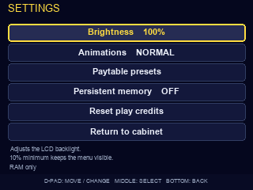
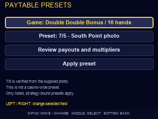
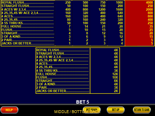
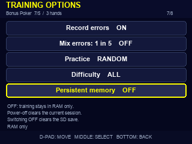
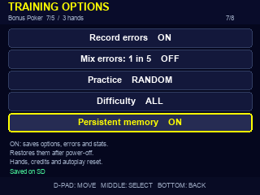
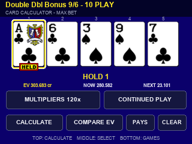

# Video Poker user guide

This guide describes **v0.6.5**. It covers the twelve-tile cabinet, ordinary play, device settings, optional SD memory, calculator and hidden trainer. All money amounts in this program are **virtual credits**.

[Install](#install-and-first-boot) · [Controls](#physical-controls) · [Cabinet](#cabinet-and-game-selection) · [Settings](#general-settings) · [Paytables](#paytable-presets-and-vegas-configurations) · [Memory](#persistent-memory) · [Calculator](#card-calculator) · [Trainer](#hidden-trainer) · [Statistics](#statistics-and-ev) · [Troubleshooting](#troubleshooting)

## Install and first boot

Use the [README flashing instructions](../README.md#quick-install) with Raspberry Pi Imager. The supplied image targets a **Raspberry Pi Zero 1.3, ST7789 display in 320 × 240 landscape orientation, D-pad with center switch and three action buttons**. A 240 × 240 display, different GPIO layout or another Pi model needs its own qualification; changing the device selector in Imager does not adapt the image.

Download the IMG and matching SHA-256 file from the same release. On macOS or Linux, run the following from the download folder:

```sh
shasum -a 256 -c videopoker-v0.6.5-pi0-320x240.img.sha256
```

The result must be `OK`. On Windows PowerShell, use `Get-FileHash .\videopoker-v0.6.5-pi0-320x240.img -Algorithm SHA256` and compare its hash with the checksum file. Hash verification checks the download; Imager's verification checks what was written to the card.

No Wi-Fi, account, phone, BIOS, game ROM or additional installation is required. The image already includes its operating system, program, artwork and offline strategy tables. Do not extract or flash the corresponding-source archive.

On boot, the first tile—**Triple Play Bonus Poker**—is highlighted. This is a fixed default. Maximum bet and the complete hand count are selected for each game. Persistent memory does not resume a live hand or automatically start the trainer.

## Physical controls

The left cluster contains UP, DOWN, LEFT, RIGHT and CENTER. The right column has TOP, MIDDLE and BOTTOM. In the tables below, **either middle** means CENTER in the left cluster or MIDDLE in the right column.

| Where | Input | Result |
| --- | --- | --- |
| Cabinet | D-pad | Move the tile selection |
| Cabinet | Either middle | Open the highlighted game |
| Cabinet on cold boot | TOP | Also opens the highlighted game |
| Cabinet opened from a game | TOP | Return to that game |
| Cabinet | BOTTOM | Open general Settings |
| Game | LEFT / RIGHT | Move the card selection or selected bottom control |
| Game, before Draw | Either middle | Hold or unhold the selected card |
| Game, completed results | Either middle | Deal the next hand |
| Game | DOWN | Deal / Draw; a fresh press can advance completed draw presentation |
| Game | BOTTOM | Move focus into or out of the bottom machine controls |
| Game | TOP | Open result-hand inspection where available |
| Manual play | Hold UP for at least 0.30 seconds | Show the recommended hold in red while held |
| Manual play | Double UP | Apply the best hold without drawing |
| Game | Triple UP | Toggle autoplay on or off |
| Autoplay | Double UP | Cycle AM → Medium → Fast → AM |
| Anywhere in the integrated app | Hold UP + DOWN together for two seconds | Open the hidden trainer menu immediately; repeat to return to regular mode |

The hidden chord fires **before release**. Release both buttons before another action or another entry gesture. Keeping them held does not toggle repeatedly. Press them together: DOWN pressed noticeably earlier is still an ordinary Deal/Draw press.

Ordinary menus use UP/DOWN to select, either middle to confirm and BOTTOM to go back. LEFT/RIGHT changes a selected value where indicated. TOP also confirms on most utility pages. Page-specific labels take precedence over these general rules.

## Cabinet and game selection

| Row | Left to right |
| --- | --- |
| Triple Play | Bonus Poker; Bonus Poker Deluxe; Double Double Bonus; Deuces Wild |
| Five Play | Jacks or Better; Double Bonus; Joker Poker; Deuces Wild |
| Ten Play | Bonus Poker; Double Double Bonus; Triple Double Bonus; Deuces Bonus Poker |

The hand evaluator and wild-card deck follow the selected game. Joker Poker has a 53-card deck. The two Deuces Wild layouts and Deuces Bonus Poker use deuces as wild cards, with their own payouts and multiplier schedules.

Select **MORE GAMES** among the bottom machine controls to return to the cabinet after finishing the current hand. Maximum bet is 10 credits per active hand: 30, 50 or 100 credits per deal for three, five or ten hands. Half funds the base poker wager and half enables the multiplier feature. The image keeps the full board and maximum bet as its normal defaults.

Credits are shared during the current power-on period. Pending multipliers are kept separately by exact game/paytable preset in RAM when moving between games. Returning to a game does not create a free new multiplier board. Power-off resets all live game boards and credits, even when training memory is enabled.

### Machine controls and result inspection

Use BOTTOM to focus the machine's gold controls, LEFT/RIGHT to move and either middle to activate. SEE PAYS shows the current game's awards and next-hand multiplier schedule. MORE GAMES returns to selection when a hand is finished. SPEED changes manual presentation speed. SELECT HANDS and BET PER HAND retain the cabinet's full-board/max-bet behavior. DEAL performs Deal/Draw; BET MAX uses the existing maximum-bet action.

After results, TOP opens individual-hand inspection. The D-pad chooses a hand; BOTTOM returns. The right middle button advances to the next deal rather than duplicating result inspection.

### Hints and hold-none feedback

Cards are numbered **1–5 from left to right**. Held UP shows thin red borders on the recommended cards and removes them as soon as UP is released. If the best decision is to hold nothing, the actual Draw button flashes red while UP is held. Quick double/triple taps do not briefly flash the hint.

Double UP selects the best cards with ordinary yellow held markers. It does not draw, spend a new wager or enable autoplay. A hint or automatic hold used during training makes the decision assisted rather than an unassisted accuracy test.

### Autoplay

Every fresh activation starts in **AM**. The footer shows `A` beside the speaker area and a small `M`, one filled triangle or two filled triangles for AM, Medium or Fast. There is no full-screen autoplay announcement.

| Mode | How it plays |
| --- | --- |
| AM | Waits for DOWN to deal. After you examine the cards, DOWN applies the best hold and draws with minimum presentation delay. Waits for the next DOWN before the next deal. |
| Medium | Deals, allows roughly 3.2 seconds to consider the hand, presents held-card selection at about 0.24 seconds per step, pauses about 0.28 seconds before Draw and shows results for about 1.35 seconds. |
| Fast | Uses about 1.6 seconds to consider, 0.12 seconds per selection step, 0.15 seconds before Draw and 0.8 seconds on results, with faster reveals. |

Those are configured stage durations, not guaranteed total hand times: selected-card count, analysis availability, rendering and the device affect the complete cycle. AM skips the automatic pacing waits.

UP alone never cancels autoplay. Double UP changes mode; triple UP explicitly turns autoplay off. Other buttons cancel autoplay and consume that stop input. In AM, DOWN is the exception: it plays the requested phase without cancelling AM. Held UP peeks in AM while you consider a dealt hand. Holding UP does not cycle speeds.

## General settings

At the cabinet, press **BOTTOM**. Settings are separate from the hidden trainer options. UP/DOWN selects a row; LEFT/RIGHT or a middle button changes or opens it. BOTTOM goes back.

| Setting | Choices and behavior |
| --- | --- |
| Brightness | 10–100% in 10% steps. Controls the LCD backlight through PWM on the established backlight pin. A 10% floor prevents selecting a black screen. |
| Animations | SLOW, NORMAL or INSTANT for manual Deal/Draw reveals. Set the saved preference here; the machine SPEED control also changes current live presentation. Autoplay keeps its own pacing profiles. |
| Paytable presets | Opens game/preset selection and paytable review. Only presets with matching strategy data can be applied. |
| Persistent memory | OFF by default; ON saves device preferences and training records. The selected setting has a short explanation below it. |
| Reset play credits | Sets virtual credits to 10,000 after the current hand is finished. It does not erase training statistics. |
| Return to cabinet | Closes Settings and returns to the cabinet view. |

Device settings take effect immediately. They survive power-off only when persistent memory is ON and the save has completed. Opening Settings pauses autoplay. No sound-volume or network option is shown because this image does not implement those services.



## Paytable presets and Vegas configurations

Open **Settings → Paytable presets**. Select the game row and use LEFT/RIGHT to choose a cabinet game. Select the preset row and use LEFT/RIGHT to choose a supported configuration. **Review payouts and multipliers** shows the actual table; **Apply preset** commits the selection. BOTTOM returns.

Three- and ten-hand Double Double Bonus each offer **9/6, 9/5, 8/5 and 7/5**. The first number is the full-house award per base credit; the second is the flush award. Other award categories and the selected hand count's original multiplier schedule remain unchanged. Other games retain their original cabinet table in this release.

The supplied South Point photograph establishes the **ten-hand DDB 7/5** configuration shown below. It is not evidence that every machine, denomination or game at that casino uses the same table. The three-hand alternate is a numeric preset using the original three-hand schedule; it is not claimed as a photographed South Point machine.

| Winning hand | One base credit | Five base credits | Next-hand multiplier, photographed ten-hand table |
| --- | ---: | ---: | ---: |
| Royal flush | 250 | 4,000 | 4× |
| Straight flush | 50 | 250 | 4× |
| Four aces with 2/3/4 kicker | 400 | 2,000 | 4× |
| Four 2s/3s/4s with A/2/3/4 kicker | 160 | 800 | 4× |
| Four aces | 160 | 800 | 4× |
| Four 2s/3s/4s | 80 | 400 | 4× |
| Four 5s through kings | 50 | 250 | 3× |
| Full house | 7 | 35 | 12× |
| Flush | 5 | 25 | 10× |
| Straight | 4 | 20 | 8× |
| Three of a kind | 3 | 15 | 4× |
| Two pair | 1 | 5 | 3× |
| Jacks or better | 1 | 5 | 2× |

[Reference photo](images/south-point-ddb-75.jpg). The royal's five-credit award includes its maximum-coin jackpot; it is not 250 × 5.

Changing a preset changes **settlement, paytable display, hints, auto-hold, autoplay, calculator and trainer EV together**. Each alternate has its own generated continuation policy and numeric checks. This is more than changing two display labels. The selected preset has separate training totals and error history. There is no unrestricted numeric paytable editor that could leave advice bound to the wrong awards.

| Select a preset | Review its complete table |
| --- | --- |
|  |  |

Finish a dealt hand before replacing its active game's preset. Applying a preset for an inactive game does not change the current game's hand. Selecting a newly used preset starts its own multiplier board; already visited presets keep their separate RAM boards. Cash denomination is not implemented: the program reports credits. With a fixed paytable, denomination alone changes dollar scale rather than card probabilities.

## Persistent memory

The toggle is available in **general Settings** and **Training options**. Both control the same global memory mode, not separate copies.

| Memory OFF | Memory ON |
| --- | --- |
|  |  |

| Mode | Saved or restored across power-off |
| --- | --- |
| OFF, factory default | No training/device history is restored or automatically written. Options, sessions, errors and statistics exist for the current power-on period. |
| ON | Device brightness, animation preference, selected paytable presets, per-preset training options, errors, learned status, session records and manual/autoplay totals. |
| Always fresh | Current cards, held flags, live credits, RNG state, current/pending game multipliers, selected boot tile, active trainer mode and active autoplay. |

Enabling memory saves the current options and records. Turning it OFF clears both saved copies, while the current in-memory training session remains usable until power-off. The next boot returns to default settings and empty history. The initial tile remains Triple Play Bonus Poker in either mode.

**Clear training data**, in Training options, has a confirmation page with CANCEL selected first. CLEAR resets training options, errors and statistics in RAM and any saved copy. It preserves the memory ON/OFF preference, device preferences and the current game hand. It does not refill virtual credits. Use it to restart your training record while continuing to save future sessions.

The options menu reports `RAM only`, `Saving...`, `Saved on SD`, a recovered-save message or an error. Background saves are coalesced at approximately two-second intervals. Wait for `Saved on SD` before unplugging if the latest result matters. Explicit ON/OFF and clear actions complete their writes before reporting success. A failed storage change remains visible for retry; it does not silently claim that persistence succeeded.

At boot, the program checks the preallocated, checksummed save region for an explicit ON preference. OFF therefore means no restored training history and no automatic history writes, rather than zero SD reads during startup. Firmware, artwork and strategy resources are also read from the card as part of boot. Legacy records from older always-saving builds do not automatically enable memory.

There are two alternating save slots, bounded to the image's reserved region. A valid older copy can recover an interrupted normal save. OFF/clear update both copies so old training data does not remain as the ordinary recovery copy. This is not encryption or a general secure-erase facility. Reflashing the complete image replaces its memory region and returns it to factory OFF.

History is bounded to **160 error records and 48 sessions**, plus per-preset totals. Old entries roll out of those lists. Totals are retained while that data remains in RAM or saved memory.

## Card calculator

Enter the hidden trainer menu using UP + DOWN for two seconds, then choose **Card calculator**. Its cabinet opens the desired game and uses the paytable preset selected in general Settings.

1. Select a card slot and press a middle button. The card picker uses the game's actual deck; duplicates are rejected. Joker is offered only for Joker Poker.
2. Choose all five cards. Completing the fifth card starts analysis automatically. Editing a complete hand, multiplier or continued-play mode requests a fresh result; incomplete hands show no old recommendation.
3. Read HOLD followed by positions 1–5. `NONE`/Draw all five means hold no cards. Yellow held markers show the recommendation.
4. Review inline **EV**, **NOW** and **NEXT**, or choose **COMPARE EV** for all 32 alternatives.

The multiplier editor matches the game's three-, five- or ten-hand layout. Select an individual hand to change its current multiplier or use the whole-board selection to set all hands together. Enter the multiplier that applies to the coming draw, not the multiplier the outcome might earn next. If all hands are 1×, leave the default. Select **CONTINUED PLAY** to value future earned multipliers, or the current-hand-only mode to exclude that continuation value.

**CALCULATE** and TOP remain available to retry. **PAYS** reviews this preset's awards. **CLEAR** removes the five entered cards. BOTTOM returns to the calculator's cabinet; BOTTOM there exits the utility. Entries for different presets are separate and remain only in RAM.

COMPARE EV opens the trainer's complete hold table even without a preceding manual Calculate. BOTTOM returns to the editor with the best hold and inline EV populated. In that table, select a hold and press middle for its payout/outcome detail.



## Hidden trainer

Hold **D-pad UP + DOWN for two seconds**. The menu appears immediately while the buttons are still held. Release them, then select an item. Repeat the chord to leave the trainer and return to normal mode. The ordinary game screen has no training labels or training sidebar.

| Menu item | What it does |
| --- | --- |
| Training: OFF / TEST / COACH | Opens Training options. |
| New session | Starts fresh session counters for this preset, retaining prior sessions and totals. If training was OFF it selects TEST. Returns to the game. |
| Your errors | Opens recorded incorrect unassisted decisions for this preset. |
| Session stats | Opens personal and autoplay statistics; change views with LEFT/RIGHT. |
| Compare hold EV | Opens all 32 holds for a dealt hand, or the most recent analyzed result where available. |
| Card calculator | Opens manual card/multiplier entry. |
| Training guide | Three built-in help pages. |
| Return to game | Closes the menu and plays with the selected training mode. |

### Training options

UP/DOWN scrolls the eight options; the counter shows the selected row. Each option has short contextual help below the list. LEFT/RIGHT changes a value, and a middle button selects an action.

| Option | Effect |
| --- | --- |
| Training type | OFF bypasses training analysis/grading; TEST conceals the solution until a decision is submitted; COACH shows the best hold beside the live game. |
| Warn on error | Before an incorrect Draw, show the better hold and EV cost beside the cards. Correct the hold, or press DOWN again to continue with the same choice. |
| Record errors | Keeps incorrect unassisted decisions for review/replay. Assisted decisions do not become personal errors. Persistence still follows the global memory mode. |
| Mix errors: 1 in 5 | Inserts an available unlearned error on every fifth training round. Those rounds restore that error's multiplier board. |
| Practice | RANDOM uses ordinary deals; ERRORS uses unlearned errors for this exact preset. If no errors are available, the program tells you rather than silently changing the exercise. |
| Difficulty | ALL uses the chosen normal/error practice flow. CLOSE and CLEAR use the original presets' validated fixed 1× drill bank. Alternate paytables do not yet have those curated banks; use ALL for them. |
| Persistent memory | Global OFF/ON setting described above. |
| Clear training data | Opens the deliberate reset confirmation described above. |

In TEST, the first submitted incorrect hold remains an error even if corrected afterward. The correction is counted separately. A second DOWN accepts that same incorrect choice; changing cards/focus cancels a queued or approved Draw. If analysis is still pending, the game waits without consuming a replacement draw or charging another deal.

Hints, double-UP auto-hold, COACH and autoplay count as assistance when seen before submission. They do not inflate personal accuracy. Entering the trainer halfway through an already dealt hand is also treated as assisted. A correct alternative with equal EV is accepted within the numerical grading tolerance.

### Live panels

The trainer keeps card-face sizes and the bottom machine controls, placing a narrow information panel beside the cards. Tap TOP to cycle **Advice → EV → Stats** without leaving play. Hold BOTTOM for one second to reopen the menu. Hold TOP on a dealt hand for the full EV table; after results it retains hand inspection behavior.

Advice shows the relevant recommendation/decision feedback. EV compares leading holds and separates immediate and continuation value. Stats shows the current personal or automatic decision coverage and results. TEST conceals the best hold until it should be revealed; COACH displays it immediately.

### Errors and replay

Select an error and press middle to review its original cards, your hold, best hold, EV lost and multiplier board. Press middle again to replay after finishing any live hand. Replay uses those exact original cards and multipliers rather than an unrelated 1× board. A correct unassisted replay marks the error learned; it remains reviewable but is excluded from unlearned-error practice.

### Full hold EV and payout detail

Five cards have 32 possible hold masks, including hold none and hold all. The ranking shows eight rows at a time; UP/DOWN or LEFT/RIGHT scrolls. A middle press opens the selected hold's outcome probabilities and EV contributions. UP/DOWN scrolls outcome categories; LEFT/RIGHT changes the hold. BOTTOM returns through the pages.

Every completion of the remaining deck is counted. Advice receives only the dealt cards, selected rules, wager/hand count and active multipliers. It does not inspect future RNG draws. The feature calculation includes a game/paytable-specific numerical continuation policy, not the ordinary single-hand poker strategy applied indiscriminately.

## Statistics and EV

Statistics belong to the exact preset, so ten-hand DDB 9/6 and ten-hand DDB 7/5 do not share a single accuracy record. Views include THIS SESSION, ALL SESSIONS, SESSION AUTOPLAY, ALL AUTOPLAY and earlier retained sessions. LEFT/RIGHT cycles views; a middle press also advances a view.

| Field | Meaning |
| --- | --- |
| Hold accuracy | Correct unassisted decisions divided by checked unassisted decisions. No decisions is shown as `--`. |
| Decisions / errors | Number of graded unassisted decisions and how many were suboptimal. |
| EV lost | Sum of the solver's best decision value minus the submitted decision value, in credits. |
| Wagered / returned | Actual virtual credits spent and paid, rather than theoretical returns. |
| Actual net | Returned minus wagered credits; random short-term wins/losses can differ substantially from decision quality. |
| Assisted / corrected | Assisted decisions and errors subsequently corrected. |
| Drawn hands / replays | Individual completed hands across the active layout and training replays. |
| Decision EV retained | Sum of played decision values divided by optimal decision values. It is a strategy-quality measure, not a casino RTP estimate. |
| Autoplay checked / decisions | Completed independent grades versus automatic decisions. A backlog or unavailable grade is visibly unchecked, never assumed correct. |

Autoplay records its actual selected hold separately from personal accuracy. Its grading queue is bounded to 32 jobs; slow or failed analysis can leave coverage below 100%. Starting a new session does not assign late grades to the wrong session.

**NOW** is expected current-board payout across the active hands and multipliers. **NEXT** is relative continued-play value of multipliers that may be earned, using an all-1× reference board. **EV = NOW + NEXT**. NEXT is not a guaranteed next-hand payout, and EV is not net profit after subtracting the current wager. Current-hand-only calculator mode removes continuation value. The project does not claim that its numeric presentation is identical to the website's XEV display.

## Troubleshooting

| Symptom | Check |
| --- | --- |
| Screen remains off | Confirm the image checksum, supported Pi/display, correct card and successful Imager verification. Imager's device selector cannot repair an image for different hardware. |
| Screen lights but no cabinet | Allow normal startup, check power and reflash the verified IMG if necessary. Report whether the backlight is off, black or shows an error. |
| Settings/history disappear | Factory default is memory OFF. Enable it, then wait for Saved on SD. Reflashing resets it. |
| SD change failed/incomplete | Retry the explicit operation. RAM data remains available during the session; the UI does not claim a completed save. A nonmatching or damaged save region is not blindly overwritten. |
| Hint seems to do nothing | Hold UP beyond 0.30 seconds on a dealt hand. If no cards should be kept, watch the red Draw button. Brief taps deliberately do not show red. |
| Autoplay stops | Triple UP stops it. Other keys stop it too, except UP and AM's DOWN. Holding a chord pauses it. |
| Menu toggles repeatedly | Release UP and DOWN fully. A continuous hold should trigger once; report repeat behavior if it occurs. |
| Calculator recommendation is stale | Editing inputs clears/replaces old analysis. Incomplete cards cannot be analyzed. TOP/Calculate retries a failed analysis. |
| New paytable appears wrong | Review every award and multiplier, not just full house/flush. The South Point label refers only to the supplied photographed configuration. |
| No Close/Clear drills for an alternate table | Use ALL. Alternate DDB strategy is included; preset-specific curated difficulty banks are not. |

## Validation and source

Host checks exercise game behavior, input sampling, no-repeat gestures, persistence transitions/recovery, paytable binding, calculator invalidation and rendering. Stock ARM emulation executes the delivered Python and strategy tables. These are software checks; physical PWM brightness, Pi timing, cold boot and buttons still require hardware testing.

The corresponding-source archive includes build tools, tests, original code, asset inventories and numerical strategy metadata. It excludes the large pinned base OS image, which can be supplied using [technical notes](TECHNICAL.md). Upstream and third-party components retain their own licenses and notices in [NOTICE](../NOTICE).
